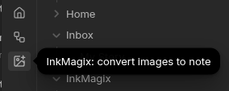
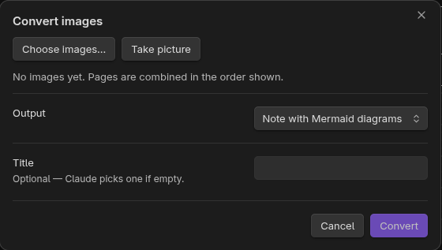
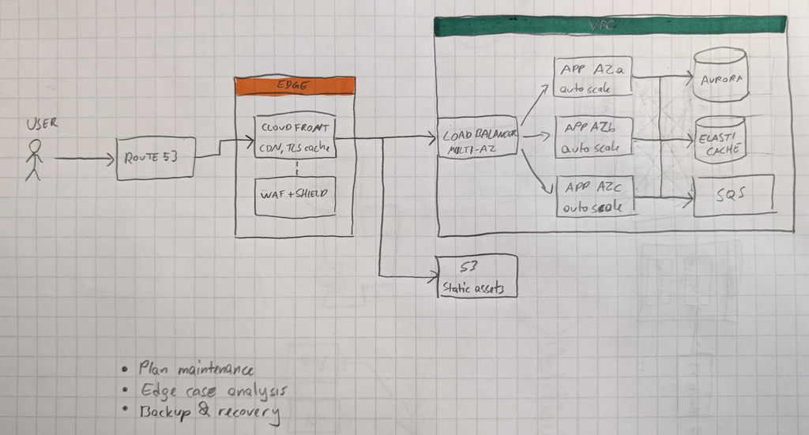
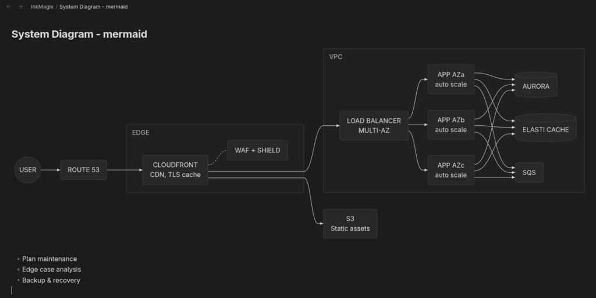
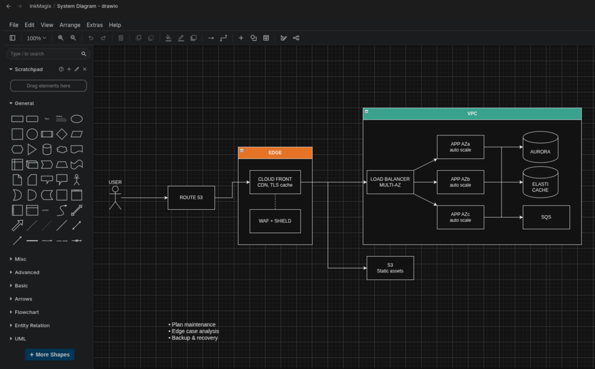

# InkMagix: image to note and diagram converter for Obsidian

Turn photos and images (handwritten notes, whiteboards, printed pages, screenshots, sketches, diagrams) into [Obsidian](https://obsidian.md) content using Claude:

- **Note with Mermaid diagrams**: a Markdown note. Any diagrams in the image are rebuilt as `mermaid` blocks.
- **draw.io diagram**: an editable `.drawio` file. Obsidian can't open `.drawio` files by itself: install a draw.io community plugin (such as Diagrams.net or draw.io editor) or open the file in the draw.io desktop app.

## Example

**Step 1: open InkMagix.** Click the InkMagix icon in the left ribbon. Its tooltip reads "InkMagix: convert images to note".



**Step 2: choose the images and the output.** The **Convert images** dialog opens. Add images with **Choose images…** or **Take picture**, pick the output (**Note with Mermaid diagrams** or **draw.io diagram**), optionally enter a title (Claude picks one if it's empty), then click **Convert**.



**Step 3: get the result.** The new note or `.drawio` file opens when the conversion finishes. Here is one hand-drawn diagram converted both ways.

**Original:** a hand-drawn AWS system diagram on grid paper. A user goes through Route 53 to an Edge group (CloudFront CDN, plus WAF + Shield), then to S3 static assets and a VPC. Inside the VPC, a multi-AZ load balancer sends traffic to three auto-scaling app instances, which connect to Aurora, ElastiCache and SQS. Three handwritten to-do bullets are at the bottom.



**Note with Mermaid diagrams:** the same image converted to an Obsidian note. The diagram is rebuilt as a Mermaid flowchart with the Edge and VPC groups, the dashed link between CloudFront and WAF, and database shapes for the data stores. The handwritten bullets become a regular Markdown list below the diagram.



**draw.io diagram:** the same image converted to an editable `.drawio` file, shown here in a draw.io editor inside Obsidian. The layout follows the sketch closely, including the user stick figure, the orange Edge and green VPC headers, cylinder shapes for Aurora and ElastiCache, and the bullet list as a text block.



## Requirements, network use and costs

- **Anthropic account and API key required.** InkMagix uses Anthropic's Claude models to read your images. Create an API key at [console.anthropic.com](https://console.anthropic.com).
- **Paid usage.** Anthropic bills API usage to your Anthropic account. InkMagix itself is free, but each conversion costs a small amount (shown after every conversion). See [Anthropic's pricing](https://www.anthropic.com/pricing).
- **Network use.** When you click **Convert**, the selected images and your instructions are sent to the Anthropic API (`api.anthropic.com`). This is the only network request the plugin makes, and it is needed because the conversion runs on Claude, not on your device.
- **Privacy.** Nothing else from your vault is sent. InkMagix collects no telemetry or analytics. Anthropic's handling of API data is described in its [privacy policy](https://www.anthropic.com/legal/privacy).

## Installation

**From Community plugins (once published):** open **Settings → Community plugins → Browse**, search for "InkMagix", install and enable it.

**Manually:** download `main.js`, `manifest.json` and `styles.css` from the [latest release](https://github.com/yamanor/obsidian-inkmagix/releases/latest) into `<vault>/.obsidian/plugins/inkmagix/`, then enable InkMagix under **Settings → Community plugins**.

Then open **Settings → InkMagix** and paste your Anthropic API key.

## Usage

Open the convert dialog from the ribbon icon or from the command palette. The commands are:

- *Convert images to note*
- *Convert image files…*
- *Take picture and convert*

In the dialog:

1. **Choose images…** or **Take picture**. On mobile, Take picture opens the native camera. On desktop, it shows a webcam preview.
2. Add as many images as you need, up to 10. They are combined in the order shown, and you can reorder them with ← / →.
3. Pick the output and optionally give a title. Instructions come from the "Default instructions" setting.
4. Click **Convert**. The new file opens when it's done. The notice also shows the tokens used and the approximate cost.

If a generated Mermaid block or the draw.io XML fails validation, InkMagix sends the errors back to Claude and asks it to fix them. It does this once.

## Settings


| Setting                | Default         | Notes                                                                      |
| ---------------------- | --------------- | -------------------------------------------------------------------------- |
| Anthropic API key      | —               | Saved in Obsidian's secret storage as `inkmagix-anthropic-api-key` (local to this device and vault, not synced). |
| Model                  | Claude Opus 5.5 | Sonnet 5.5 and Haiku 5.5 are cheaper. A custom model ID is also supported. |
| Effort                 | High            | Higher effort is more accurate on messy handwriting and complex diagrams.  |
| Note folder            | `InkMagix`      | Created automatically if it doesn't exist.                                 |
| Enable draw.io output  | On              | Off hides the draw.io option, so every conversion creates a Mermaid note.  |
| Default diagram format | Mermaid         | Shown only while draw.io output is enabled.                                |
| Add properties         | Off             | Adds `created`, `source` and `model` properties to new notes.              |
| Keep original photo    | Off             | When on, the original image is saved and embedded in a collapsed callout.  |
| Max output tokens      | 50000           |                                                                            |
| Max image size         | 2576 px         | Size of the image's long edge after downscaling.                           |
| Default instructions   | —               | Added to every conversion.                                                 |


## Image size

Images are processed on the device before upload:

- The EXIF orientation is applied.
- Transparency is filled with white.
- Each image is downscaled so its long edge is **at most 2576 px** and its total size is **at most about 3.75 MP**. Images are never upscaled.
- The result is encoded as JPEG at about 85% quality.

2576 px is the most detail current Claude models make use of, at up to about 4.8K input tokens per image. Larger images would only add upload time. Choose 1568 or 1280 px in settings to save tokens on simple images.

HEIC photos can't be decoded on desktop. Export them as JPEG or PNG first. The mobile camera already produces JPEG.

## Development

```bash
npm install
npm run dev     # watch build
npm run build   # type-check + production build → main.js
npm test        # unit tests (vitest)
```

To try it out, copy or symlink `main.js`, `manifest.json` and `styles.css` into `<vault>/.obsidian/plugins/inkmagix/`, then enable the plugin.

### Releasing

Bump `version` in `manifest.json`, `package.json` and `versions.json`, commit, then push a tag with exactly that version (no `v` prefix):

```bash
git tag 0.1.1 && git push origin 0.1.1
```

The GitHub Actions workflow builds, tests and publishes a release with `main.js`, `manifest.json` and `styles.css` attached.

## License

[MIT](LICENSE)